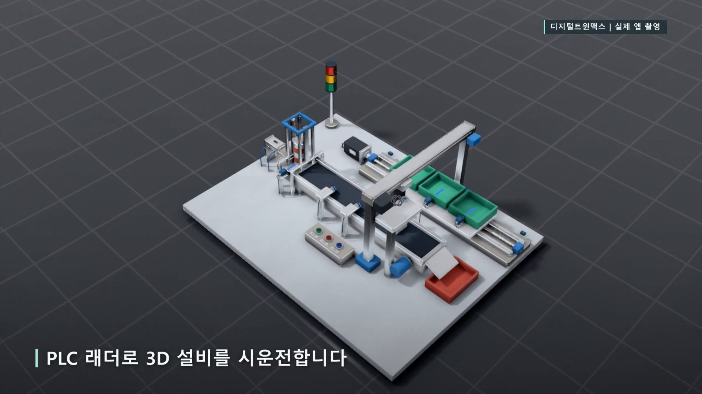
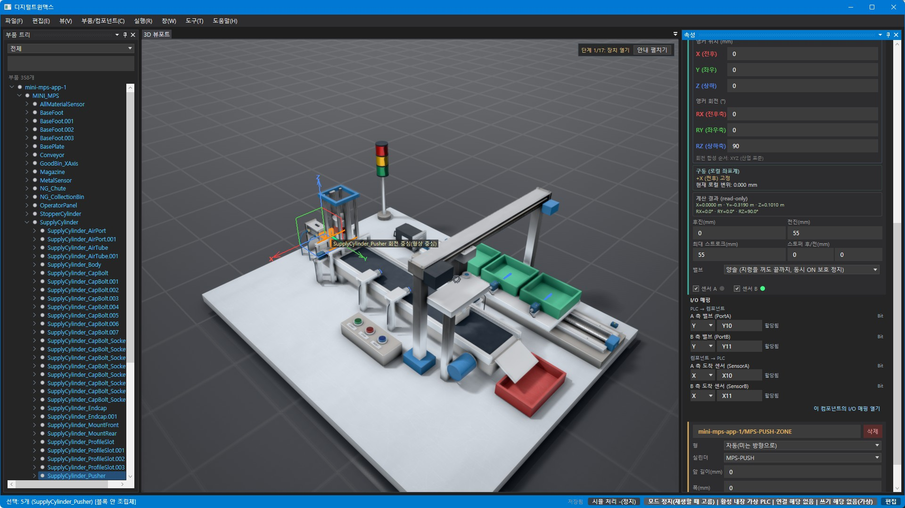

# 디지털트윈맥스 (DigitalTwinMax)

**내가 짠 래더로 움직이는 3D 설비**

장비를 조립하기 전에 3D 설비 모델로 PLC 제어 프로그램을 시운전하는 Windows 데스크톱 앱입니다.

[공식 소개 페이지](https://plcmanjp.github.io/digitaltwinmax/) | [무료 체험판 다운로드 (Releases)](https://github.com/plcmanjp/digitaltwinmax/releases) | [체험판 설문](https://docs.google.com/forms/d/e/1FAIpQLSc0Yhx-0pLgTDBpMvXx29FrXEcGQxNz2F5vwyN28JjxgcMViw/viewform) | [의견 및 버그 제보](https://github.com/plcmanjp/digitaltwinmax/issues) | [도입 문의](mailto:digitaltwinmax@googlegroups.com)



---

## 왜 디지털트윈맥스인가

- **조립이 끝나기 전에 시작합니다**: 3D 설비 모델이 있으면 장비 제작과 배선이 끝나기 전에 제어 프로그램을 먼저 돌려 보며 현장 시운전 부담을 줄입니다.
- **장비 파손 없이 반복 시험합니다**: 잘못된 출력에도 가상 설비는 부딪히거나 망가지지 않습니다. 동작 순서 오류와 센서 누락 조건을 책상 위 PC에서 안전하게 반복 검증합니다.
- **PC 한 대로 실습과 검토를 함께**: 실물 교육 장비가 부족한 현장이나 교육장에서도 PC 한 대로 래더 신호와 3D 설비 반응을 동시에 확인할 수 있습니다.

---

## 핵심 워크플로 및 아키텍처

형상은 CAD에서, 동작과 PLC 신호는 앱에서 설정해 바로 시운전합니다.

1. **STEP 01. 설비 모델과 부품 트리**: 제품판에서는 설계한 STEP 파일(`.step`, `.stp`)을 바로 열고, 무료 체험판에서는 내장된 MINI MPS 교육 장비(358부품)의 부품 계층 트리와 3D 뷰포트를 확인합니다.
2. **STEP 02. 구동부와 I/O 주소 매핑**: 선택한 부품에 실린더나 센서 컴포넌트를 추가하고, 스크립트 작성 없이 전진 거리(mm)와 밸브/센서 PLC 주소를 속성 패널에 입력합니다.
3. **STEP 03. 가상 실행과 PLC 연동**: PLC 없이 내장 신호 시뮬레이터로 동작을 먼저 점검하고, MX Component 또는 이더넷 MC 프로토콜로 제어 프로그램과 연결해 시운전합니다.



### 실시간 PLC 양방향 신호 교환

구동부와 센서의 포트를 PLC 디바이스 주소에 매핑하면 출력 명령과 센서 감지 상태가 실시간으로 오갑니다. PLC 제어 프로그램은 기존 개발 환경(GX Works2)에서 준비합니다.

| 방향 | 대상 | 주고받는 신호 |
|---|---|---|
| `PLC -> 디지털트윈맥스` | 출력 (`Y`, Word) | 밸브 개폐, 실린더 및 컨베이어 구동 명령 |
| `디지털트윈맥스 -> PLC` | 입력 (`X`, Word) | 실린더 도착, 공작물(워크) 유무 및 센서 감지 상태 |

### 주요 기능 요약

- **내장 신호 시뮬레이터**: PLC나 시뮬레이터를 연결하기 전에도 앱 내부에서 출력 비트를 직접 제어하며 기구 방향과 센서 위치를 먼저 검증합니다.
- **미쓰비시 Q 시리즈 연동**: MX Component 논리 국번으로 같은 PC의 GX Simulator2 또는 실제 Q 시리즈 PLC에 연결하며, 이더넷 환경에서는 MC 프로토콜(SLMP)을 지원합니다.
- **STEP 임포트와 프로젝트 저장**: 제품판은 STEP 파일을 직접 불러오며, 체험판과 제품판 모두 설정한 프로젝트를 저장해 다음 검토에 다시 열 수 있습니다.
- **AI 에이전트 연동 (MCP)**: MCP를 지원하는 외부 AI 에이전트가 설비 구성과 PLC 신호 할당 상태를 조회할 수 있습니다. 편집안 제안과 앱 내 사람 승인 기능은 개발 중이며 현재 체험판에는 포함되지 않습니다.

---

## 무료 체험판 안내

신청 절차 없이 [GitHub Releases](https://github.com/plcmanjp/digitaltwinmax/releases) 또는 [공식 소개 페이지](https://plcmanjp.github.io/digitaltwinmax/#trial)에서 바로 내려받을 수 있는 무료 체험판입니다. 사용 기한이 없습니다.

### 체험판 시작 3단계

1. **PLC 없이 가상 실행**: 앱을 열고 I/O 주소가 미리 할당된 MINI MPS 장비를 내장 신호 시뮬레이터로 먼저 움직여 봅니다.
2. **I/O 주소표 확인과 저장**: 센서와 구동부에 연결된 PLC 주소를 매핑 창에서 확인하고, 설정을 바꿔 저장하거나 다시 열 수 있습니다.
3. **래더를 짜서 연동 시운전**: GX Works2에서 직접 작성한 래더(샘플 래더 미포함)를 연결해 공급, 판별, 분류 과제를 시운전합니다.

---

## 무료 체험판과 제품판 비교

| 구분 | 무료 체험판 | 제품판 |
|---|---|---|
| **설비 3D 모델** | 내장 MINI MPS 교육 장비 제공 | 설계한 STEP 파일(`.step`, `.stp`) 직접 불러오기 |
| **가상 실행과 수동 시험** | 포함 (PLC 없이 신호 시뮬레이터 구동) | 포함 |
| **미쓰비시 Q PLC 연동** | 포함 (MX Component, 이더넷 MC 프로토콜) | 포함 |
| **프로젝트 저장과 다시 열기** | 내장 MINI MPS 설정 변경 후 저장/열기 가능 | 모든 설비 프로젝트 저장/열기 가능 |
| **이용 조건** | 신청 없이 무료 다운로드, 사용 기한 없음 | 추후 별도 안내 (도입 문의 접수 중) |
| **AI 에이전트 연동(MCP)** | 미포함 | 지원 예정 (읽기와 편집안 승인) |

---

## 필요한 환경 및 다운로드 전 확인

### 지원 환경

- **운영체제**: Windows 10 또는 Windows 11 (64비트, x64) PC. 가상 실행과 기본 조작은 추가 프로그램 없이 바로 실행할 수 있습니다.
- **PLC 연동 시**: GX Works2와 MX Component가 설치된 환경(MX Component는 체험판에 포함되지 않음), 또는 이더넷 MC 프로토콜 연결 환경.
- **지원 PLC**: 미쓰비시 Q 시리즈 (GX Simulator2 또는 실제 Q PLC 연결, GX Works3 기반 FX5 및 iQ-R 시리즈는 지원하지 않음).

### 안전 및 파일 무결성 확인

- **Windows 보호 창(SmartScreen)**: 초기 체험판에는 코드 서명이 적용되어 있지 않아 실행 시 Windows 보호 창이 표시될 수 있습니다. 릴리스 노트의 SHA-256 해시와 내려받은 파일의 해시가 일치하는지 먼저 확인한 뒤 **추가 정보**에서 실행하세요.
- **PowerShell SHA-256 해시 확인**:
  ```powershell
  Get-FileHash .\DigitalTwinMax-Trial-*-windows-x64.zip -Algorithm SHA256
  ```
- **실물 PLC 시험 주의**: 실제 PLC로 시험할 때는 출력에 물리 설비가 연결되지 않은 안전한 시험용 환경에서 진행하세요.

---

## 의견 제보, 알림 구독 및 권리 고지

- **체험 후 설문**: 앱 종료 시 선택형 설문 참여 여부를 묻습니다. 실행에 막혔거나 의견을 남기시려면 [체험판 설문(Google Forms)](https://docs.google.com/forms/d/e/1FAIpQLSc0Yhx-0pLgTDBpMvXx29FrXEcGQxNz2F5vwyN28JjxgcMViw/viewform)에 로그인 없이 응답하실 수 있습니다. 설문 응답은 수집일로부터 90일 이후 순차 삭제되며, 앱은 설문 응답이나 프로젝트 파일, 사용 기록을 자동으로 전송하지 않습니다.
- **버그 및 기능 제안**: [공개 GitHub Issues](https://github.com/plcmanjp/digitaltwinmax/issues)에 남겨 주세요. 공개 게시판이므로 개인정보, 연락처, 고객 도면, PLC 네트워크 주소 등 민감정보는 올리지 마세요.
- **비공개 및 도입 문의**: [digitaltwinmax@googlegroups.com](mailto:digitaltwinmax@googlegroups.com)
- **새 체험판 알림 구독**: 이 저장소 상단의 `Watch -> Custom -> Releases`를 선택하거나, [Google 소식 그룹](https://groups.google.com/g/digitaltwinmax-tester) 가입 또는 [구독 메일 보내기](mailto:digitaltwinmax-tester+subscribe@googlegroups.com?subject=subscribe)를 이용해 주세요.
- **권리 및 상표 고지**: 본 저장소는 공개 제품 소개 페이지와 체험판 릴리스 배포를 위한 공간이며, 오픈소스 라이선스를 부여하지 않습니다. `Mitsubishi`, `GX Works`, `MELSEC` 명칭은 호환성 설명 목적으로만 표기하며 제조사의 공식 인증이나 제휴를 의미하지 않습니다.
